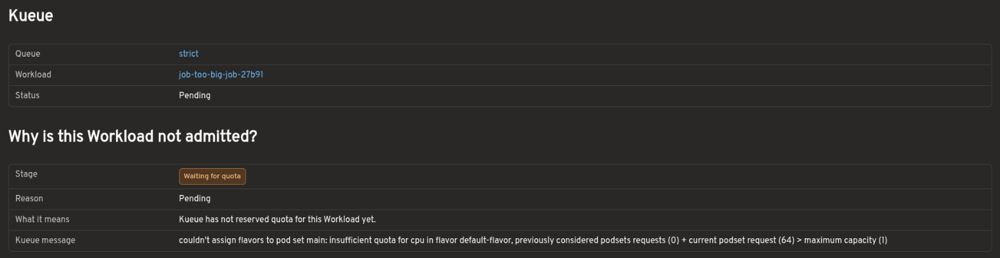
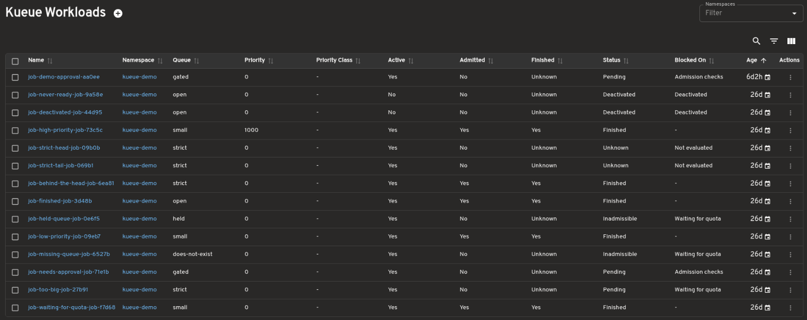
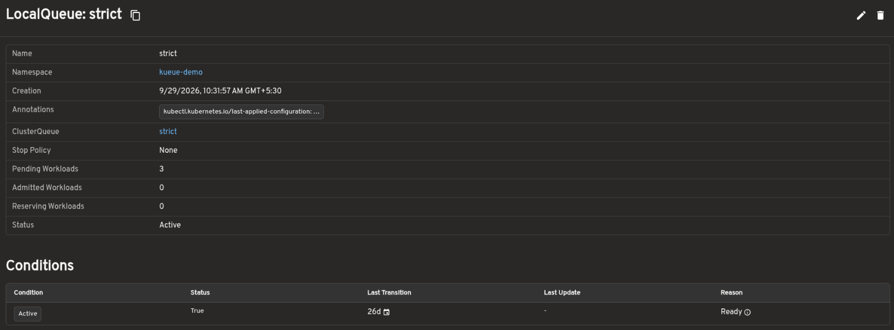
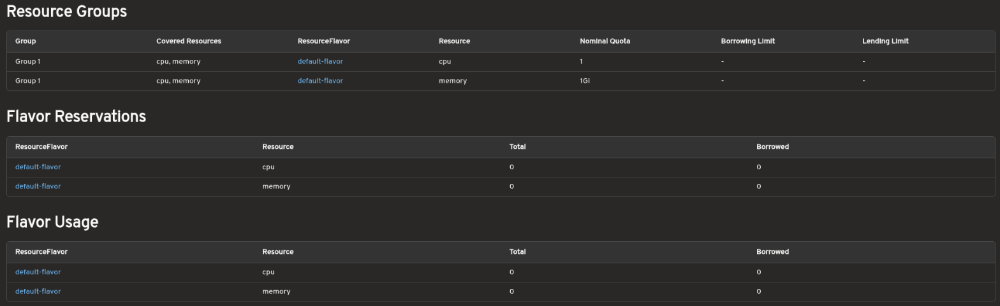

# Kueue Headlamp Plugin

This plugin adds an initial Headlamp UI for [Kueue](https://kueue.sigs.k8s.io/docs/overview/), a Kubernetes-native system for batch workload queueing.

See the [Kueue getting started guide](https://kueue.sigs.k8s.io/docs/getting-started/) to install Kueue and create the queueing resources required by a cluster.

## Current Scope

This plugin currently reads Kueue `Cohort`, `ClusterQueue`, `LocalQueue`, `ResourceFlavor`, and `Workload` resources from the Kubernetes API and displays them in basic list and detail pages. It registers a Kueue sidebar section with entries for these resources.

The views are read-only. Cohort pages show parent and child Cohort relationships, member ClusterQueues, ResourceFlavor references, resource groups, and fair-sharing values.

Related Cohorts, ClusterQueues, LocalQueues, ResourceFlavors, and Workloads are linked so users can follow the queueing path between resources. The plugin checks Kubernetes permissions before loading resource pages and shows an access message when the current user cannot view a resource.

## Prerequisites

Kueue CRDs must be installed in the cluster before the plugin can list resources. See the [Kueue installation guide](https://kueue.sigs.k8s.io/docs/getting-started/installation/) for installation instructions.

You can check for the `Cohort`, `ClusterQueue`, `LocalQueue`, `ResourceFlavor`, and `Workload` CRDs and resources with:

```bash
kubectl get crd cohorts.kueue.x-k8s.io
kubectl get crd clusterqueues.kueue.x-k8s.io
kubectl get crd localqueues.kueue.x-k8s.io
kubectl get crd resourceflavors.kueue.x-k8s.io
kubectl get crd workloads.kueue.x-k8s.io
kubectl get cohorts
kubectl get cohort default -o yaml
kubectl get clusterqueues
kubectl get localqueues -A
kubectl get localqueue <name> -n <namespace> -o yaml
kubectl get resourceflavors
kubectl get workloads -A
kubectl get workload <name> -n <namespace> -o yaml
```

## Test Files

Sample `Cohort`, `ClusterQueue`, `LocalQueue`, `ResourceFlavor`, and Job manifests are available in `test-files/deploy/`. The sample ClusterQueue belongs to the `default` Cohort, and the sample Job uses the `team-a-queue` LocalQueue so Kueue can create a real `Workload` for local UI testing.

Apply them to a cluster with Kueue installed:

```bash
kubectl apply -f test-files/deploy/resourceflavor-default.yaml
kubectl apply -f test-files/deploy/resourceflavor-spot.yaml
kubectl apply -f test-files/deploy/resourceflavor-topology.yaml
kubectl apply -f test-files/deploy/cohort-default.yaml
kubectl apply -f test-files/deploy/clusterqueue-team-a.yaml
kubectl apply -f test-files/deploy/localqueue-team-a.yaml
kubectl apply -f test-files/deploy/job-sample-workload.yaml
kubectl get cohorts
kubectl get workloads -A
```

After applying the examples, open `Kueue` > `Cohorts`, `Kueue` > `ClusterQueues`, `Kueue` > `LocalQueues`, `Kueue` > `ResourceFlavors`, or `Kueue` > `Workloads` in Headlamp.

## Troubleshooting a Pending Workload

When a Job submitted to Kueue does not start, follow it from the Job to the queue that is holding it back. The screenshots follow a Job that requests 64 CPUs from a ClusterQueue with a nominal quota of 1 CPU.

1. **Job.** Open the Job in `Workloads` > `Jobs`. The Jobs list has `Queue` and `Kueue Status` columns, and the Job detail page has a `Kueue` section with its LocalQueue, its Workload and the Workload's status. If the section is missing, the Job has no `kueue.x-k8s.io/queue-name` label, so Kueue is not managing it. If the Workload shows `Not created yet`, Kueue has not picked up the Job; check that the LocalQueue exists in the Job's namespace.

   ```bash
   kubectl get job <name> -n <namespace> -o jsonpath='{.metadata.labels.kueue\.x-k8s\.io/queue-name}'
   kubectl get workloads -n <namespace> -l kueue.x-k8s.io/job-uid=$(kubectl get job <name> -n <namespace> -o jsonpath='{.metadata.uid}')
   ```

   

2. **Workload.** Open the Workload from the Job's `Kueue` section, or find it in `Kueue` > `Workloads`, where the `Blocked On` column shows the stage for each Workload. The `Why is this Workload not admitted?` section on the Workload page (also shown on the Job page) names the stage it is waiting at, the reason Kueue reported, what that reason means and Kueue's own message:

   - `Not evaluated`: Kueue has not tried to reserve quota yet. The Workload is usually queued behind others.
   - `Waiting for quota`: the ClusterQueue cannot reserve quota for it. The reason says whether there is not enough unused quota, the request is larger than the ClusterQueue could ever provide, or no ResourceFlavor matches the Workload.
   - `Admission checks`: quota is reserved but admission checks are not `Ready`. `Blocking admission checks` lists them; open each one from `Kueue` > `AdmissionChecks`.
   - `Topology assignment`: quota is reserved but Kueue is still placing the pods for a topology-aware request.
   - `Evicted`: the Workload was admitted and then evicted, for example by preemption. When Kueue backs off before requeueing it, `Next retry` shows when.
   - `Deactivated`: `spec.active` is false, or Kueue is about to set it, so Kueue will not admit the Workload.

   The `Lifecycle` section shows which stages it has passed and how long it has waited at the current one.

   ```bash
   kubectl get workload <name> -n <namespace> -o jsonpath='{range .status.conditions[*]}{.type}={.status} {.reason}: {.message}{"\n"}{end}'
   ```

   

3. **LocalQueue.** Follow the `Queue` link. The LocalQueue page shows its ClusterQueue, its `Stop Policy`, its `Status` and how many Workloads are pending, reserving quota and admitted. A `Stop Policy` of `Hold` or `HoldAndDrain`, or a `Status` of `Inactive`, stops every Workload in the queue; the Conditions section says why a queue is inactive.

   ```bash
   kubectl get localqueue <name> -n <namespace> -o yaml
   ```

   

4. **ClusterQueue.** Follow the `ClusterQueue` link. Compare `Resource Groups`, which shows the nominal quota and borrowing limit per ResourceFlavor and resource, with `Flavor Reservations` and `Flavor Usage`, which show how much of it is taken. If the quota is used up, the Workload waits until running Workloads finish, or until the ClusterQueue can borrow from its `Cohort`. `Pending Workloads` counts every Workload waiting across all of its LocalQueues, and the ClusterQueue has its own `Stop Policy` and `Status`.

   ```bash
   kubectl get clusterqueue <name> -o yaml
   ```

   

## Development

```bash
npm install
npm run format
npm run build
npm run tsc
npm run lint
npm run test
```
